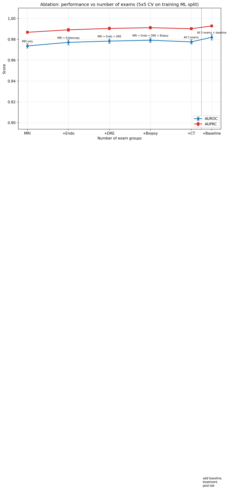
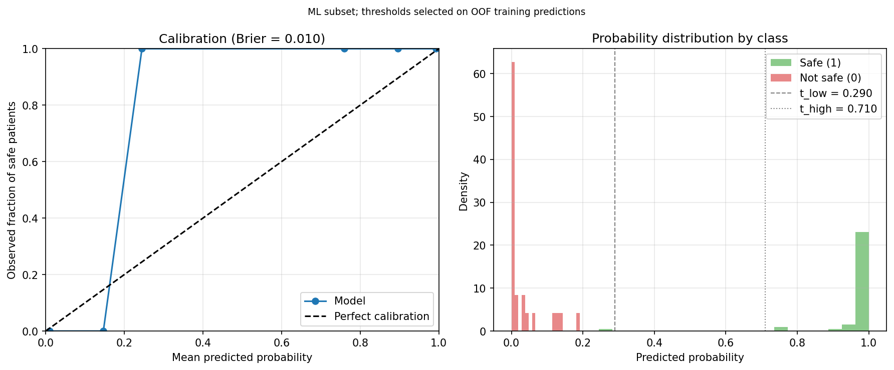
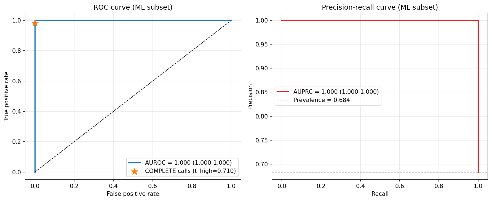
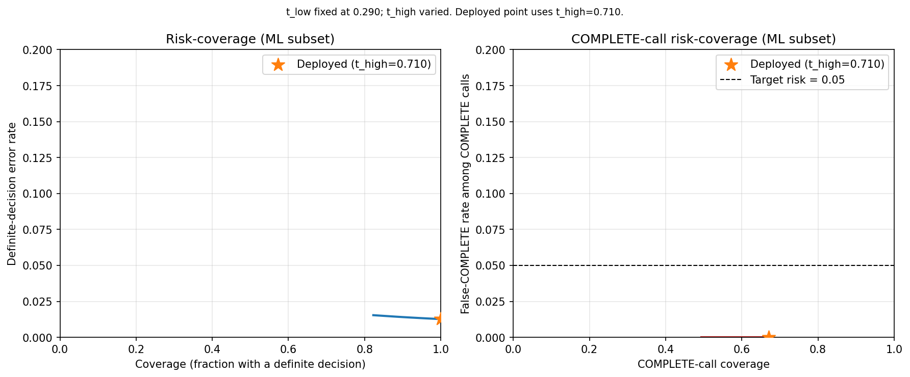
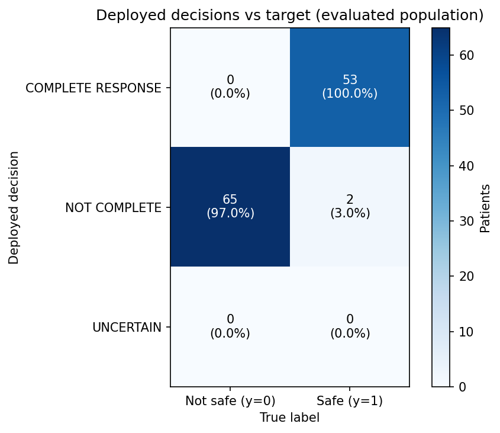
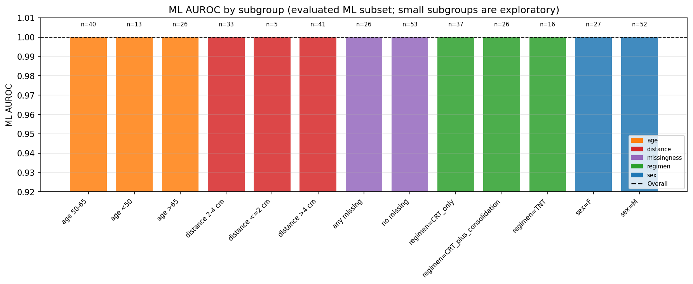
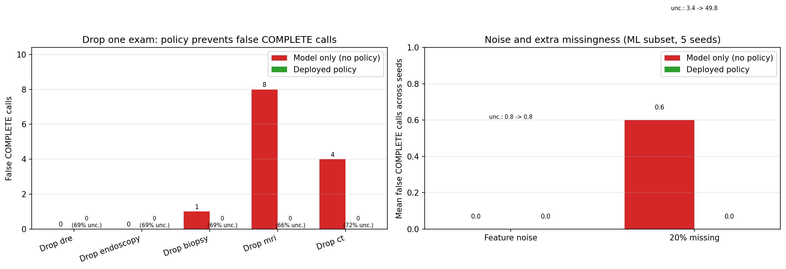

# Rectal cancer post-CRT decision support - evaluation report

**Evaluated split:** TEST  
**Generated:** 2026-11-22T04:05:02  
**Model:** `logistic_l2` with calibration `none`; thresholds `t_low=0.290`, `t_high=0.710`.  
**Model version:** `v1.0`

## Scope and honest framing

The pipeline, decision logic, abstention behaviour and interface are demonstrated on the provided exam-output data; clinical validation requires external real cases with the same schema, split by patient.

This is decision support only. It is not an autonomous diagnostic device. Every definite COMPLETE or NOT COMPLETE call must be reviewed by the multidisciplinary team (MDT).

The provided dataset is highly separable. Near-ceiling AUROC is a property of this dataset and should not be read as clinical-grade performance.

## Test-set discipline

The test split was scored exactly once (`test_eval_count = 1`). No test labels or metrics were used for model selection, calibration, threshold selection, feature selection, or example selection.

- Model selection: repeated 5x5 cross-validation on the training split only.
- Calibration selection: repeated 5x5 cross-validation on the training split only.
- Threshold selection: out-of-fold (OOF) predictions from the training split, using the bootstrap lower-bound rule in `src/config.py`.
- Validation split: confirmation only; it did not choose the model, calibration, or thresholds.

## Data audit

| Item | Value |
|---|---|
| Rows | 800 |
| Columns | 49 |
| Safe (target=1) | 370 |
| Not safe (target=0) | 430 |
| Prevalence | 0.463 |
| Hard-stopped patients | 304 |
| ML-eligible patients | 496 |
| Local complete but distant progression | 38 |
| ML features | 43 |
| All features (incl. CT progression rule input) | 44 |

Split sizes (full population / ML-eligible):

| Split | Full | ML-eligible |
|---|---|---|
| Train | 559 | 342 |
| Validation | 121 | 75 |
| Test | 120 | 79 |

Missingness and exam availability:

| Column / exam | Missing (n) |
|---|---|
| `pre_mri_ADC_mean` | 71 |
| `mri_DWI_restriction` | 41 |
| `mri_ADC_mean` | 71 |
| `mri_wall_thickness_mm` | 31 |
| `post_CEA_ng_ml` | 99 |
| Key exam column: DRE | 0 |
| Key exam column: Endoscopy | 0 |
| Key exam column: Biopsy | 0 |
| Key exam column: Pelvic MRI | 0 |
| Key exam column: Thoraco-abdomino-pelvic CT | 0 |

### Layer 1 hard stops

| Rule | Patients | Correct NOT COMPLETE | False NOT COMPLETE | Agreement |
|---|---|---|---|---|
| ct_distant_progression==1 | 120 | 120 | 0 | 100.0% |
| bx_result==positive | 121 | 121 | 0 | 100.0% |
| endo_finding==visible_tumor | 123 | 116 | 7 | 94.3% |
| dre_finding==palpable_mass | 91 | 86 | 5 | 94.5% |

Combined: **304** patients hard-stopped, **293** correct (96.4%), **11** false NOT COMPLETE. The 11 false NOT COMPLETE patients are true complete responders who were forced to NOT COMPLETE. This is a safety-conservative error, but it is an error and is reported.

The target is a composite: `safe_for_watch_and_wait = 1` requires local complete response (`residual_tumor = 0`) and no distant progression (`ct_distant_progression = 0`). The 38 patients with local complete response but distant progression are correctly excluded by the CT hard stop.

## Model and thresholds

Selected model: **logistic_l2**; calibration: **none**; OOF AUROC **0.9840**, OOF Brier **0.0408**; validation AUROC **0.9982**, validation Brier **0.0207**.

Thresholds: `t_low = 0.290`, `t_high = 0.710`. Selection rule: OOF bootstrap lower-bound rule. OOF coverage **93.3%**; OOF PPV **0.9752**; OOF NPV **0.9610**. Fallback used: t_high=no, t_low=no.

Candidate models (repeated 5x5 CV on training):

| Model | AUROC | AUPRC | Brier | Log loss |
|---|---|---|---|---|
| logistic_l2 | 0.9820 +/- 0.0027 | 0.9929 +/- 0.0011 | 0.0441 +/- 0.0044 | 0.1472 |
| logistic_l1 | 0.9791 +/- 0.0033 | 0.9906 +/- 0.0019 | 0.0439 +/- 0.0036 | 0.1523 |
| hgb | 0.9756 +/- 0.0057 | 0.9892 +/- 0.0034 | 0.0507 +/- 0.0069 | 0.1822 |
| hgb_conservative | 0.9773 +/- 0.0043 | 0.9906 +/- 0.0022 | 0.0477 +/- 0.0043 | 0.1643 |

Calibration comparison (repeated 5x5 CV on training):

| Calibration | Brier | Brier SD | Log loss | AUROC |
|---|---|---|---|---|
| none | 0.0441 | 0.0044 | 0.1472 | 0.982 |
| sigmoid | 0.047 | 0.0028 | 0.1711 | 0.9821 |
| isotonic | 0.0446 | 0.0049 | 0.2067 | 0.9759 |

The uncalibrated logistic model was selected because its OOF Brier and log loss were best or tied; a small Brier difference is broken in favour of simplicity.

## Primary metrics

| Population | n | Prevalence | AUROC (95% CI) | AUPRC (95% CI) | Brier (95% CI) | PPV COMPLETE (95% CI) | NPV NOT COMPLETE (95% CI) | Sensitivity | Specificity | False-COMPLETE rate | Coverage | UNCERTAIN |
|---|---|---|---|---|---|---|---|---|---|---|---|---|
| Full deployed pipeline (TEST) | 120 | 0.458 | 0.987 (0.958-1.000) | 0.990 (0.966-1.000) | 0.015 (0.001-0.037) | 1.000 (1.000-1.000) | 0.970 (0.923-1.000) | 0.964 (0.906-1.000) | 1.000 (1.000-1.000) | 0.000 (0.000-0.000) | 100.0% | 0 |
| ML-only model | 79 | 0.684 | 1.000 (1.000-1.000) | 1.000 (1.000-1.000) | 0.010 (0.001-0.025) | 1.000 (1.000-1.000) | 0.962 (0.875-1.000) | 0.981 (0.941-1.000) | 1.000 (1.000-1.000) | 0.000 (0.000-0.000) | 100.0% | 0 |

Full-pipeline ranking metrics assign score 0 to rule-based NOT COMPLETE decisions; they describe the deployed ordering, not model calibration. Calibration and ROC/PR figures use the ML subset. The full pipeline made **53** COMPLETE calls, **67** NOT COMPLETE calls and **0** UNCERTAIN calls.

The ML-only metrics use the hard-stop-eligible subset and ignore the missing-exam policy; the full pipeline applies both. This is why the two populations can differ.

## Baselines

| Population | n | Prevalence | AUROC (95% CI) | AUPRC (95% CI) | Brier (95% CI) | PPV COMPLETE (95% CI) | NPV NOT COMPLETE (95% CI) | Sensitivity | Specificity | False-COMPLETE rate | Coverage | UNCERTAIN |
|---|---|---|---|---|---|---|---|---|---|---|---|---|
| B0 majority (full) | 120 | 0.458 | 0.500 (0.500-0.500) | 0.458 (0.367-0.550) | 0.458 (0.367-0.550) | n/a | 0.542 (0.450-0.633) | 0.000 (0.000-0.000) | 1.000 (1.000-1.000) | 0.000 (0.000-0.000) | 100.0% | 0 |
| B0 majority (ML) | 79 | 0.684 | 0.500 (0.500-0.500) | 0.684 (0.582-0.785) | 0.316 (0.215-0.418) | 0.684 (0.582-0.772) | n/a | 1.000 (1.000-1.000) | 0.000 (0.000-0.000) | 1.000 (1.000-1.000) | 100.0% | 0 |
| B1 rule protocol (full) | 120 | 0.458 | 0.686 (0.617-0.757) | 0.637 (0.524-0.733) | 0.292 (0.217-0.367) | 0.885 (0.750-1.000) | 0.660 (0.563-0.756) | 0.418 (0.292-0.545) | 0.954 (0.894-1.000) | 0.046 (0.000-0.103) | 100.0% | 0 |
| B2 8-feature logistic (ML, threshold 0.5) | 79 | 0.684 | 0.995 (0.982-1.000) | 0.998 (0.992-1.000) | 0.033 (0.013-0.058) | 0.946 (0.879-1.000) | 0.957 (0.857-1.000) | 0.981 (0.941-1.000) | 0.880 (0.737-1.000) | 0.120 (0.000-0.269) | 100.0% | 0 |
| B2 with M thresholds (ML, sensitivity) | 79 | 0.684 | 0.995 (0.982-1.000) | 0.998 (0.992-1.000) | 0.033 (0.013-0.058) | 0.981 (0.936-1.000) | 0.950 (0.833-1.000) | 0.963 (0.909-1.000) | 0.760 (0.583-0.920) | 0.040 (0.000-0.133) | 92.4% | 6 |
| M full model (full) | 120 | 0.458 | 0.987 (0.958-1.000) | 0.990 (0.966-1.000) | 0.015 (0.001-0.037) | 1.000 (1.000-1.000) | 0.970 (0.923-1.000) | 0.964 (0.906-1.000) | 1.000 (1.000-1.000) | 0.000 (0.000-0.000) | 100.0% | 0 |
| M full model (ML) | 79 | 0.684 | 1.000 (1.000-1.000) | 1.000 (1.000-1.000) | 0.010 (0.001-0.025) | 1.000 (1.000-1.000) | 0.962 (0.875-1.000) | 0.981 (0.941-1.000) | 1.000 (1.000-1.000) | 0.000 (0.000-0.000) | 100.0% | 0 |

B0 is the majority-class baseline. B1 is the simple rule protocol without abstention. B2 is a logistic model on 8 hand-picked features without abstention. B2 AUROC is **0.995 (0.982-1.000)** versus M ML AUROC **1.000 (1.000-1.000)**: this is essentially parity. The honest interpretation is that the tabular signal is strong and the 8-feature baseline captures most of it. The contribution of M is the safety layer, abstention, exam-level explanation, and interface, not a large discrimination gain over B2.

B2 with M's thresholds is a sensitivity analysis; its coverage (92.4%) and PPV/NPV are not directly comparable because the thresholds were selected for M.

## Ablation by exam

| Feature set | Exams | Features | AUROC | AUPRC | Brier |
|---|---|---|---|---|---|
| MRI only | 1 | 13 | 0.9737 +/- 0.0021 | 0.9868 +/- 0.0011 | 0.0491 +/- 0.0039 |
| MRI + Endoscopy | 2 | 17 | 0.9771 +/- 0.0024 | 0.9892 +/- 0.0015 | 0.0432 +/- 0.0037 |
| MRI + Endo + DRE | 3 | 19 | 0.9783 +/- 0.0021 | 0.9905 +/- 0.0013 | 0.0428 +/- 0.0029 |
| MRI + Endo + DRE + Biopsy | 4 | 23 | 0.9792 +/- 0.0022 | 0.9912 +/- 0.0013 | 0.0442 +/- 0.0019 |
| All 5 exams | 5 | 28 | 0.9776 +/- 0.0021 | 0.9902 +/- 0.0011 | 0.0448 +/- 0.0024 |
| All 5 exams + baseline | 5 | 43 | 0.9820 +/- 0.0027 | 0.9929 +/- 0.0011 | 0.0441 +/- 0.0044 |

Repeated 5x5 CV on the training ML split, using the same model class and calibration as the final model. The CT group excludes `ct_distant_progression` because Layer 1 removes every patient with distant progression; within the ML population that column is constant. The last point adds baseline, treatment and post-treatment lab features. It should be close to the OOF AUROC, which is a consistency check.



Interpretation: AUROC rises from MRI-only through the four-exam sets; adding CT alone is roughly flat in this dataset, and the best CV AUROC comes from the full feature set. The gains are small, and the 8-feature B2 baseline already captures most of the discrimination. The novelty is the safety/abstention layer, not a large raw AUROC gain.

## Calibration and abstention







Coverage is **100.0%** on the ML subset and **100.0%** for the full deployed pipeline. The tool abstains on **0** ML patients and **0** full-pipeline patients rather than forcing a call.

The risk-coverage curve uses the ML subset with `t_low` fixed at the selected value and `t_high` varied. Panel (a) shows the definite-decision error rate vs coverage; panel (b) shows the false-COMPLETE rate among COMPLETE calls vs COMPLETE-call coverage, with the 95% PPV target line. The deployed point is marked. This is the honest trade-off: higher coverage is possible, but only by accepting a higher false-COMPLETE risk.



Full-pipeline confusion matrix: 0 false COMPLETE calls and 2 missed complete responders (NOT COMPLETE on true safe). The missed complete responders include the hard-stop false NOT COMPLETE patients.

## Subgroups

| Subgroup | Family | n full | n ML | Prevalence | ML AUROC | PPV COMPLETE | False-COMPLETE | Coverage | Reliable |
|---|---|---|---|---|---|---|---|---|---|
| sex=M | sex | 76 | 52 | 0.474 | 1.0000 | 1.000 (1.000-1.000) | 0.000 (0.000-0.000) | 100.0% | yes |
| sex=F | sex | 44 | 27 | 0.432 | 1.0000 | 1.000 (1.000-1.000) | 0.000 (0.000-0.000) | 100.0% | yes |
| age <50 | age | 22 | 13 | 0.455 | 1.0000 | 1.000 (1.000-1.000) | 0.000 (0.000-0.000) | 100.0% | yes |
| age 50-65 | age | 59 | 40 | 0.508 | 1.0000 | 1.000 (1.000-1.000) | 0.000 (0.000-0.000) | 100.0% | yes |
| age >65 | age | 39 | 26 | 0.385 | 1.0000 | 1.000 (1.000-1.000) | 0.000 (0.000-0.000) | 100.0% | yes |
| regimen=CRT_only | regimen | 59 | 37 | 0.441 | 1.0000 | 1.000 (1.000-1.000) | 0.000 (0.000-0.000) | 100.0% | yes |
| regimen=CRT_plus_consolidation | regimen | 31 | 26 | 0.581 | 1.0000 | 1.000 (1.000-1.000) | 0.000 (0.000-0.000) | 100.0% | yes |
| regimen=TNT | regimen | 30 | 16 | 0.367 | 1.0000 | 1.000 (1.000-1.000) | 0.000 (0.000-0.000) | 100.0% | yes |
| distance <=2 cm | distance | 6 | 5 | 0.500 | 1.0000 | 1.000 (1.000-1.000) | 0.000 (0.000-0.000) | 100.0% | no |
| distance 2-4 cm | distance | 58 | 33 | 0.466 | 1.0000 | 1.000 (1.000-1.000) | 0.000 (0.000-0.000) | 100.0% | yes |
| distance >4 cm | distance | 56 | 41 | 0.446 | 1.0000 | 1.000 (1.000-1.000) | 0.000 (0.000-0.000) | 100.0% | yes |
| any missing | missingness | 40 | 26 | 0.525 | 1.0000 | 1.000 (1.000-1.000) | 0.000 (0.000-0.000) | 100.0% | yes |
| no missing | missingness | 80 | 53 | 0.425 | 1.0000 | 1.000 (1.000-1.000) | 0.000 (0.000-0.000) | 100.0% | yes |

Subgroups with fewer than 5 patients in the evaluated split are omitted from the table. Reliable = at least 10 patients in the full subgroup and at least 5 in each target class; smaller subgroups are exploratory and should not drive conclusions. The age bands are `<50`, `50-65`, `>65` (50 belongs to `50-65`, 65 to `>65`); distance bands are `<=2 cm`, `2-4 cm`, `>4 cm` (2 belongs to `2-4`, 4 to `>4`).

Gaps across reliable subgroups:

- **age**: AUROC gap 0.0000, PPV gap 0.0000, coverage gap 0.0% (3 reliable subgroups).
- **distance**: AUROC gap 0.0000, PPV gap 0.0000, coverage gap 0.0% (2 reliable subgroups).
- **missingness**: AUROC gap 0.0000, PPV gap 0.0000, coverage gap 0.0% (2 reliable subgroups).
- **regimen**: AUROC gap 0.0000, PPV gap 0.0000, coverage gap 0.0% (3 reliable subgroups).
- **sex**: AUROC gap 0.0000, PPV gap 0.0000, coverage gap 0.0% (2 reliable subgroups).



## Robustness

| Scenario | n | Model-only AUROC | Model-only false COMPLETE | Deployed false COMPLETE | Deployed UNCERTAIN | Notes |
|---|---|---|---|---|---|---|
| Drop DRE | 83 | 1.0000 | 0 | 0 | 69.2% | Deployed policy forces UNCERTAIN for 83 non-hard-stopped patients; deployed COMPLETE calls = 0. |
| Drop Endoscopy | 83 | 0.9935 | 0 | 0 | 69.2% | Deployed policy forces UNCERTAIN for 83 non-hard-stopped patients; deployed COMPLETE calls = 0. |
| Drop Biopsy | 83 | 0.9981 | 1 | 0 | 69.2% | Deployed policy forces UNCERTAIN for 83 non-hard-stopped patients; deployed COMPLETE calls = 0. |
| Drop Pelvic MRI | 79 | 0.9570 | 8 | 0 | 65.8% | Deployed policy forces UNCERTAIN for 79 non-hard-stopped patients; deployed COMPLETE calls = 0. |
| Drop Thoraco-abdomino-pelvic CT | 87 | 0.9574 | 4 | 0 | 72.5% | Deployed policy forces UNCERTAIN for 87 non-hard-stopped patients; deployed COMPLETE calls = 0. Model-only path would call 4 of 8 distant-progression patients COMPLETE. |
| Feature noise (5 seeds) | 79 | 0.9997 | 0.0 | 0.0 | 1.0% | ML subset. Model-only ignores the missing-exam policy; deployed applies it. Noise alone does not create missing key exams, so the policy does not block on noise alone. |
| 20% extra missingness (5 seeds) | 79 | 0.9981 | 0.6 | 0.0 | 63.0% | ML subset. The deployed policy forces UNCERTAIN when a key exam column is missing; the model-only path imputes and continues. |

Drop-exam analysis: the deployed missing-exam policy forces UNCERTAIN for every non-hard-stopped patient when a required exam is missing, so deployed COMPLETE calls are zero. The model-only column shows what would happen if the model were trusted without the policy. For CT, the model-only path calls distant-progression patients COMPLETE; the policy prevents exactly this failure. The deployed pipeline still has hard-stop false NOT COMPLETE errors, which are reported separately in the data audit.

Noise: Gaussian noise at 0.2x the training standard deviation on `mri_ADC_mean` and `mri_wall_thickness_mm`, and a 10% label flip on `mri_DWI_restriction`, over 5 seeds. Extra missingness: each ML feature is independently set missing with probability 0.2, over 5 seeds. Both use the ML evaluated subset. Model-only ignores the policy; deployed applies it. The policy trades coverage for safety.



## Validation confirmation

The validation split was used only to confirm the selected model, calibration and thresholds. It did not choose them.

| Population | n | AUROC | Brier | PPV COMPLETE | NPV NOT COMPLETE | Coverage |
|---|---|---|---|---|---|---|
| Validation full | 121 | 0.988 (0.960-1.000) | 0.021 (0.004-0.044) | 1.000 (1.000-1.000) | 0.970 (0.922-1.000) | 98.3% |
| Validation ML | 75 | 0.998 (0.992-1.000) | 0.021 (0.002-0.046) | 1.000 (1.000-1.000) | 0.950 (0.824-1.000) | 97.3% |

Training-time confirmation: PPV 1.0000 (lower 1.0000), NPV 0.9500 (lower 0.8500), coverage 97.3%. Passes PPV rule: True; passes NPV rule: False.

**Honest caveat:** the OOF threshold selection passed the NPV rule on training OOF, but the training-time validation confirmation (computed on the ML subset, model only) did not: the NPV point estimate was 0.9500, but the 95% lower bound was 0.8500, below the 0.90 target. In this evaluation the ML-only validation NPV is 0.950 (0.824-1.000), while the full deployed pipeline (rules + model) has 0.970 (0.922-1.000). The full pipeline's higher NPV is partly due to hard-stop NOT COMPLETE calls and does not rescue the model-only NPV rule. The model-only NPV rule is therefore not confirmed; this is a limitation and is not hidden.

## Shuffled-label control and leakage checks

Shuffled training labels: AUROC **0.5311** (SD 0.1651, range 0.2891-0.7382, 5 shuffles). Expected ~0.5. This confirms that the pipeline is not leaking the target through preprocessing or split handling.

| Leakage check | Result |
|---|---|
| Overall | PASSED |
| Target columns in ML features | none |
| Target columns in prepared X | none |
| Target columns in preprocessor input | none |
| Duplicate patient IDs | 0 |
| Splits disjoint | True |
| ct_distant_progression in ML features | False |
| residual_tumor=0 equals local_residual_tumor=0 | True |
| local_residual_tumor=0 equals response_category=complete | True |
| safe = local complete AND no distant progression | True |

`ct_distant_progression` is a Layer 1 rule input and is deliberately excluded from the ML feature matrix. The target columns are never passed to `prepare_dataframe`.

## Limitations and what this is not

- **Data:** provided exam-output data, not external prospective cases. Clinical validation requires external real cases with the same schema, split by patient.
- **Sample size:** the evaluated population is small (full n=120, ML n=79). Confidence intervals are wide; subgroup estimates are exploratory.
- **Near-ceiling performance:** the dataset is highly separable; AUROC near 1.0 is a dataset property, not evidence of clinical-grade performance.
- **B2 parity:** an 8-feature logistic model is essentially at parity with the full model. The full model's value is the safety layer, abstention, exam-level explanation and interface, not a large discrimination gain.
- **Hard stops are not perfect:** the rules make 11 false NOT COMPLETE calls. They are conservative, not error-free.
- **No imaging model:** the tool uses structured exam outputs, not raw MRI/CT images. It does not replace radiology or pathology review.
- **No survival endpoint:** the target is a composite watch-and-wait safety label, not disease-free survival. The tool does not predict recurrence or survival.
- **No external validation or prospective silent trial:** calibration drift and workflow impact are unknown.
- **Local demo only:** the app runs locally, makes no network calls, and stores only a salted SHA-256 audit hash of the patient ID. It is not a regulated device.

## Reproducibility

```powershell
pip install -r requirements.txt
python -m src.train
python -m src.evaluate --split val
python -m src.evaluate --split test
streamlit run app/app.py
python -m pytest -q
```

The test evaluation is guarded: if `reports/metrics.json` exists, the command refuses to run unless `--force` is passed. A forced rerun increments `test_eval_count` and is disclosed at the top of this report.

Environment:

| Package | Version |
|---|---|
| python | 3.11.9 |
| platform | Windows-10-10.0.26300-SP0 |
| numpy | 2.4.3 |
| pandas | 2.3.3 |
| scikit_learn | 1.9.0 |
| matplotlib | 3.10.8 |
| joblib | 1.5.3 |
| streamlit | 1.67.0 |
| shap | 0.51.0 |

## Figures

| Figure | File |
|---|---|
| Calibration (ML subset) | `figures/calibration_ml.png` |
| ROC and PR (ML subset) | `figures/roc_pr_ml.png` |
| Risk-coverage (ML subset) | `figures/risk_coverage.png` |
| Confusion matrix | `figures/confusion_matrix.png` |
| Ablation by exam | `figures/ablation_by_exam.png` |
| Subgroups | `figures/subgroups.png` |
| Robustness | `figures/robustness.png` |

## Bottom line

The deployed pipeline made **53** COMPLETE calls with **1.000 (1.000-1.000)** PPV and **0** false COMPLETE calls; it abstained on **0** patients. The ML model alone achieved AUROC **1.000 (1.000-1.000)** on the ML subset. The rules correctly handled **293/304** hard-stop patients (96.4% agreement) and made **11** false NOT COMPLETE calls. This is a working, auditable decision-support prototype; it is not clinically validated.
